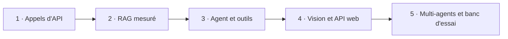

# Présentation

Hello, je suis élève ingénieur généraliste à Centrale Lyon, actuellement en stage marketing et IA chez ADEN Immo, à Berlin.

Je me forme à l'ingénierie IA en construisant 5 projets sur mon temps libre. Tout tourne en local, avec des modèles ouverts, et chaque projet se mesure.

## Ce que je fais en stage

- SEO et GEO du site : visibilité dans Google et dans les assistants IA
- Workflows n8n : automatisations, alertes Slack, rapports
- Chatbot construit en interne : RAG sur des guides, WhatsApp et site
- Outillage IA de l'équipe : prompts, Claude Code, documentation

## Les 5 projets

Dans l'ordre. Chacun réutilise ce que le précédent m'a appris.

| N° | Projet | Thème | Ce que j'y apprends | État |
|---|---|---|---|---|
| 1 | [Lecteur d'étiquettes de vin](https://github.com/burgycharlespro-lab/01-etiquettes-vin) | Vin et cépages | Appels d'API de modèles, sorties structurées, images, gestion des erreurs | À démarrer |
| 2 | [Guide de l'Alsace](https://github.com/burgycharlespro-lab/02-guide-alsace) | Alsace | RAG, réponses avec sources, refus des questions hors corpus | À démarrer |
| 3 | [Agent supersonique](https://github.com/burgycharlespro-lab/03-agent-supersonique) | Écoulements compressibles | Appel d'outils, boucle d'agent, garde-fous, serveur MCP | À démarrer |
| 4 | [Escrime, de la vidéo à une API](https://github.com/burgycharlespro-lab/04-escrime-video) | Escrime | Vision, apprentissage classique, API web, tests automatiques | À démarrer |
| 5 | [Jeu de figurines](https://github.com/burgycharlespro-lab/05-jeu-figurines) | Jeux de plateau | Agents avec état, multi-agents, banc d'essai | À démarrer |

Les guides communs (installation, choix des modèles, architecture, évaluation) sont dans [00-guides](https://github.com/burgycharlespro-lab/00-guides).

## Ma façon de travailler

À mon sens, un projet d'IA sans chiffre reste une démo.

- Aucun chiffre inventé : un score vient d'une mesure datée, avec la commande pour la refaire.
- Le modèle propose, le code vérifie : sorties validées, garde-fous, rien d'inventé.
- Zéro coût : modèles locaux avec Ollama, bibliothèques libres, licence MIT.
- Je note ce qui ne marche pas encore.
- Quand j'utilise Claude, je le dis. Les cours que je suis et la structure de départ des dépôts ont été préparés avec Claude Code. Le code, les données et les mesures sont les miens.

## Outils de ces projets

Ce sont les outils prévus dans les projets, pas encore tous pratiqués.

## En dehors du code

- L'Alsace et ses vins
- La mécanique des fluides, surtout les écoulements supersoniques
- L'escrime
- Les jeux de figurines

Ce sont aussi les thèmes des 5 projets.

## Contact

[LinkedIn](https://www.linkedin.com/in/charles-burgy-176091321)

Si tu as des retours à me faire sur un projet, n'hésite pas.
