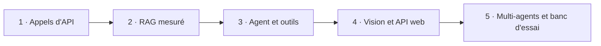

# Bonjour, je suis Charles Burgy 👋

**J'apprends l'ingénierie IA en construisant 5 projets, en local, avec des modèles ouverts et des résultats mesurés.**

[À compléter : une phrase sur ta formation et ton école.]
[À compléter : une phrase sur ce que tu cherches — stage, alternance, premier poste — et à partir de quand.]

## 🧭 Ma démarche

- **Tout tourne en local**, avec des modèles ouverts (Ollama). Aucun service payant.
- **Chaque projet se mesure** : un jeu d'évaluation, un score, et la liste de ce qui échoue encore.
- **Le modèle propose, le code vérifie** : sorties validées, garde-fous, rien d'inventé.
- **Open source**, sous licence MIT, sans but commercial.

## 🗺️ Feuille de route

Cinq projets, dans l'ordre. Chacun réutilise ce que le précédent m'a appris.

| N° | Projet | Thème | Ce que j'y apprends | État |
|---|---|---|---|---|
| 1 | [Lecteur d'étiquettes de vin](https://github.com/burgycharlespro-lab/01-etiquettes-vin) | Vin et cépages | Appels d'API de modèles, sorties structurées, images, gestion des erreurs | 🔜 À démarrer |
| 2 | [Guide de l'Alsace](https://github.com/burgycharlespro-lab/02-guide-alsace) | Alsace | RAG, réponses avec sources, refus des questions hors corpus | 🔜 À démarrer |
| 3 | [Agent supersonique](https://github.com/burgycharlespro-lab/03-agent-supersonique) | Écoulements compressibles | Appel d'outils, boucle d'agent, garde-fous, serveur MCP | 🔜 À démarrer |
| 4 | [Escrime, de la vidéo à une API](https://github.com/burgycharlespro-lab/04-escrime-video) | Escrime | Vision, apprentissage classique, API web, tests automatiques | 🔜 À démarrer |
| 5 | [Jeu de figurines](https://github.com/burgycharlespro-lab/05-jeu-figurines) | Jeux de plateau | Agents avec état, multi-agents, banc d'essai | 🔜 À démarrer |

États possibles : 🔜 À démarrer · ⏳ En cours · ✅ Terminé

Les guides communs (installation, choix des modèles, architecture, évaluation) sont dans [00-guides](https://github.com/burgycharlespro-lab/00-guides).

## 🧰 Outils de ces projets

Ce sont les outils prévus dans les projets. Je les coche au fur et à mesure que je les ai vraiment utilisés.

## 🤝 Qui a fait quoi

Les cours que je suis et la structure de départ des dépôts ont été préparés avec Claude Code (Anthropic). Le code, les données et les mesures sont les miens. Chaque dépôt le précise dans sa section « Crédits ».

## 🎯 En dehors du code

Alsace et vins d'Alsace · mécanique des fluides, écoulements supersoniques · escrime · jeux de figurines. Ce sont aussi les thèmes des cinq projets.

## 📫 Me contacter

[À compléter : lien LinkedIn et, si tu le souhaites, une adresse de contact.]
