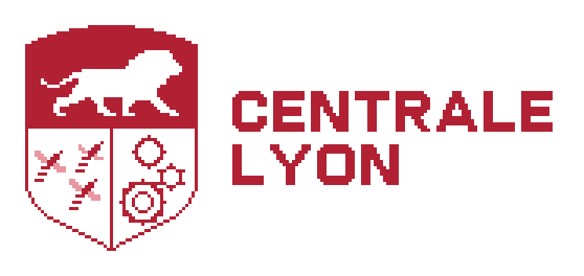
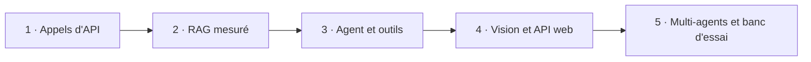

  <picture>
    <source media="(prefers-color-scheme: dark)" srcset="assets/centrale-lyon-pixel-sombre.gif">
    
  </picture>

# Présentation

Élève césuré ingénieur généraliste à Centrale Lyon, actuellement en stage chez ADEN Immo, à Berlin où je travaille sur l'automatisation de nombreux processus via n8n ainsi que sur l'intégration de l'IA afin de fluidifier un maximum de processus.

En parallèle de ce stage, je me forme à l'ingénierie IA en construisant 5 projets sur mon temps libre. Mon objectif est de faire un ensemble de tests pour m'approprier un ensemble de concepts fondamentaux à l'usage conscient de l'IA.

## Mes missions :

- SEO et GEO du site : visibilité dans Google et dans les assistants IA
- Workflows n8n : automatisations, alertes Slack, rapports
- Chatbot construit en interne : RAG sur des guides, WhatsApp et site
- Outillage IA de l'équipe : prompts, Claude Code, documentation

Je travaille aussi sur des contenus pour ADEN Immo, qui rejoindront ce portfolio à la fin du stage.

## Mes 5 projets initiaux

Dans l'ordre. Chacun est censé réutiliser ce que le précédent enseigne, puis permettre de construire de nouveaux savoir-faire.

| N° | Projet | Thème | Connaissance ciblée | État |
|---|---|---|---|---|
| 1 | [Lecteur d'étiquettes de vin](https://github.com/burgycharlespro-lab/01-etiquettes-vin) | Vin et cépages | Appels d'API de modèles, sorties structurées, images, gestion des erreurs | À démarrer |
| 2 | [Guide de l'Alsace](https://github.com/burgycharlespro-lab/02-guide-alsace) | Alsace | RAG, réponses avec sources, refus des questions hors corpus | À démarrer |
| 3 | [Agent supersonique](https://github.com/burgycharlespro-lab/03-agent-supersonique) | Écoulements compressibles | Appel d'outils, boucle d'agent, garde-fous, serveur MCP | À démarrer |
| 4 | [Escrime, de la vidéo à une API](https://github.com/burgycharlespro-lab/04-escrime-video) | Escrime | Vision, apprentissage classique, API web, tests automatiques | À démarrer |
| 5 | [Jeu de figurines](https://github.com/burgycharlespro-lab/05-jeu-figurines) | Jeux de plateau | Agents avec état, multi-agents, banc d'essai | À démarrer |

Les guides communs (installation, choix des modèles, architecture, évaluation) sont dans [00-guides](https://github.com/burgycharlespro-lab/00-guides).

## Les objectifs

À mon sens, un projet d'IA sans chiffre reste une démo, un usage vaut avant tout par sa robustesse et son utilité pratique.

- Mesures des performances : un score vient d'une mesure datée, avec la commande pour la refaire.
- Le modèle a pour but de proposer (boîte noire), le code de vérifier (déterministe) : sorties validées, garde-fous, rien d'inventé.
- Budget nul : modèles locaux avec Ollama, bibliothèques libres, licence MIT.
- Documenter ce qui ne marche pas encore.
- Usage de l'IA générative dédié au code : les cours que je suis et la structure de départ des dépôts ont été préparés avec Claude Code. Le code, les données et les mesures sont les miens, le but n'est pas tant d'accumuler des projets vitrines vides de sens, mais plutôt de monter en compétence dans ma maîtrise des grands concepts.

## Outils de ces projets (prévisionnel)

## En dehors du code, ces projets initiaux ont été produits selon des thématiques qui m'intéressent, avec comme objectif d'attribuer un rôle de professeur à Claude.

- L'Alsace et ses vins
- La mécanique des fluides, surtout les écoulements supersoniques
- L'escrime
- Les jeux de figurines

Ces thèmes touchent à mes centres d'intérêt professionnels mais aussi privés.

## Contact

[LinkedIn](https://www.linkedin.com/in/charles-burgy-176091321)
[Mail](mailto:burgycharlespro@gmail.com)
